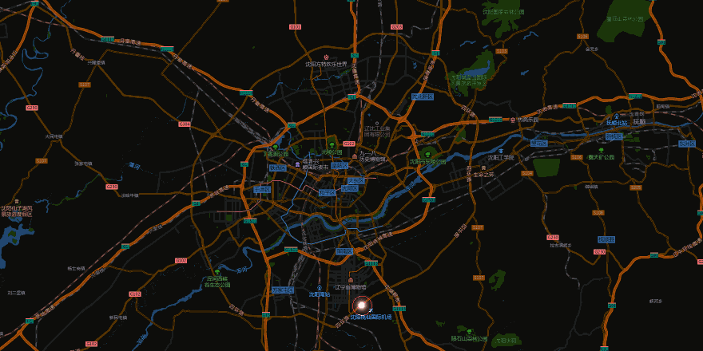
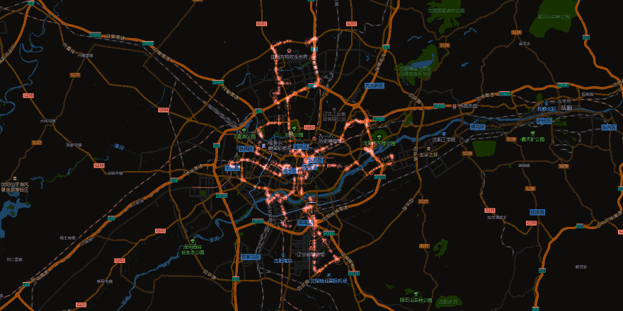

# NIO-Dash · NAS

**把蔚来车辆看板放进 NAS，7×24 小时采集，浏览器随时打开。**

<p align="center">
  
</p>

<p align="center">
  
</p>

<p align="center">
  <sub>以上为<b>合成演示数据</b>（沈阳，20 段环形路线），不是任何真实车主轨迹。</sub>
</p>

---

## 这是什么

蔚来的车辆数据走的是需要签名的网关：一部分接口只要 Bearer Token，另一部分（车况整包、换电、家充）要求请求带上签名。桌面版客户端在的时候没问题，但笔记本合上，数据就断了。

这个项目把采集和看板搬到一台常年开机的 NAS 上：

- 后台进程按「行驶 / 驻车 / 白天 / 夜间」切换轮询间隔，24 小时记录车辆状态；
- 前端是一个纯浏览器看板，手机、平板、另一台电脑都能开；
- 轨迹按月落成一个文件，逐点存经纬度与时间，可以回放、看点云、看常去地点；
- 所有数据留在这台 NAS 上，不上传任何第三方服务。

## 现在做到哪了

| 状态 | 内容 |
| --- | --- |
| ✅ 已完成 | 采集与调度、车辆看板、轨迹页与回放引擎、月度账本与年报、Token 更新与失效提示、备份/恢复、同步健康、告警、存储治理、PWA 基础、轨迹索引自检 |
| 🚧 未做 / 暂缓 | TLS + 登录（当前定位纯内网，风险已记录）、电池衰减分析（依赖每日快照，尚未补全）、GPX 导出、日历热力图 |
| 🧱 技术债 | macOS/Electron 遗留代码仍在本仓库（桌面版已迁移到独立仓库），逐步剥离 |

## 功能

### 采集

- **多槽位 Token**：车辆、换电、签到分别记录状态（`ok` / `sign_expired` / `missing`），失效时在界面上直接提示，不影响其它接口。
- **免签网关**：车辆状态、最近行程、当日里程走免签名网关，只填 Bearer 即可。
- **轨迹补全**：按月抓取，支持断点续抓；每天 04:00 自动刷新当月文件。
- **调度**：行驶中 15 分钟、白天 30 分钟、夜间 60 分钟，可配置。

### 看板

- 卡片可拖拽、隐藏、恢复；布局带版本号，升级时一次性迁移。
- **注意力卡**：车况过期、连续失败、未锁车、门窗未关、胎压异常、12V 低压、保养到期等 8 类规则，只报真正需要处理的事。
- **本月账本**：里程、环比、换电次数与花费、每公里成本。
- 数据缺失时不假装正常——字段没有就跳过，不用 0 填充。

### 轨迹

- **三种视图**：轨迹线、点云（按停留密度合并）、常去地点与流向。
- **时间范围**：日 / 周 / 月 / 自定义区间，区间内自动补拉缺失月份。
- **回放**：彗星头沿线前进，尾迹衰减到固定亮度后留痕；支持 0.1×～10× 速度、单趟聚焦、跟随居中、锁定缩放、8 套配色。
- **底图自选**：高德标准/卫星、Esri 深色/浅色/卫星，按是否有高德 Key 自动降级。
- **索引自检**：启动时比对 `tracks-index.json` 与实际月文件，不一致可一键重建。

### 运维

- **备份**：每日 19:30（UTC）打包 `data/` 与 `.env`，带 manifest 与 sha256；保留 7 日 / 4 周 / 6 月；支持校验恢复。
- **同步健康**：`/api/sync-health` 汇总各槽位状态、最近成功时间、失败次数，前端顶部横幅提示。
- **告警**：通用 Webhook + 企业微信机器人，按事件去重、失败重试；可在界面里配置和发测试消息。
- **存储治理**：按类别统计占用（轨迹、备份、配置、日志）、磁盘余量、30 天日志自动裁剪。
- **PWA**：manifest、图标、Service Worker 都已就位；局域网 HTTP 属非安全上下文，SW 不会注册，HTTPS 后自动生效。
- **守护**：`run-nas.sh` 守护进程，崩溃 10 秒后自动拉起。

## 架构

```
浏览器 ──HTTP──> 8788 serve-web ──/api/*──> 8789 app-server
                    │                          │
                    ├─ dist/ 静态前端           ├─ 车辆网关 / 换电 / 签到
                    ├─ /data/* 数据文件         ├─ 备份 / 告警 / 健康 / 分析
                    └─ /api/tracks/* 轨迹       └─ 配置读写（.env）
```

- **8788**：对外唯一端口，静态页面 + 数据文件 + 轨迹接口，其余 `/api/*` 反向代理到 8789。
- **8789**：只监听本机，不直接暴露。
- **数据目录**（默认 `/workspace/nio-dash/data`，可用 `NIO_DATA_DIR` 覆盖）：`vehicle.json`、`history.json`、`change.json`、`tracks-YYYY-MM.json`、`tracks-index.json`、`card-layout.json` 等，全部是普通 JSON 文件，没有数据库。
- **部署**：QNAP Container Station + QTS 反向代理，步骤见 [`deploy/NAS.md`](deploy/NAS.md)。

## 快速开始

需要 Node 20+（开发机用 Node 24 验证）。

```bash
npm ci
cp deploy/.env.example deploy/.env   # 填入 NIO_ACCESS_TOKEN
npm run build
sh run-nas.sh start                  # 8788 看板 / 8789 内部接口
```

常用命令：

| 命令 | 作用 |
| --- | --- |
| `npm test` | 单元测试（`node --import tsx --test`） |
| `npm run typecheck` | `tsc --noEmit` |
| `npm run build` | Vite 构建到 `dist/` |
| `npm run serve:web` | 前台运行网页服务 |
| `sh run-nas.sh status` | 查看服务与轨迹进度 |
| `npm run tracks:fetch -- --months 17` | 补历史轨迹 |

## 数据与隐私

- 车辆数据、Token、高德 Key 只存在于 NAS 本地：`deploy/.env`（权限 600，已被 git 忽略）和 `data/`。
- 仓库里**没有任何真实 Token、密钥、车牌、VIN、住址或真实轨迹**；README 的动图是脚本生成的合成数据。
- 应用默认只监听内网，不带登录——这是当前的范围决定，风险写在 `deploy/NAS.md` 与审计记录里：**不要把端口映射到公网**。

## 声明

个人项目，与蔚来官方无关。接口来自公开客户端行为，仅供个人自用；请遵守相关服务条款，不要用于商业用途或批量抓取。
